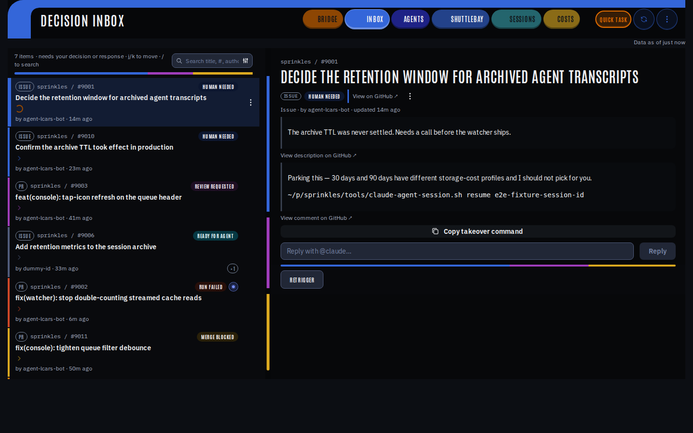
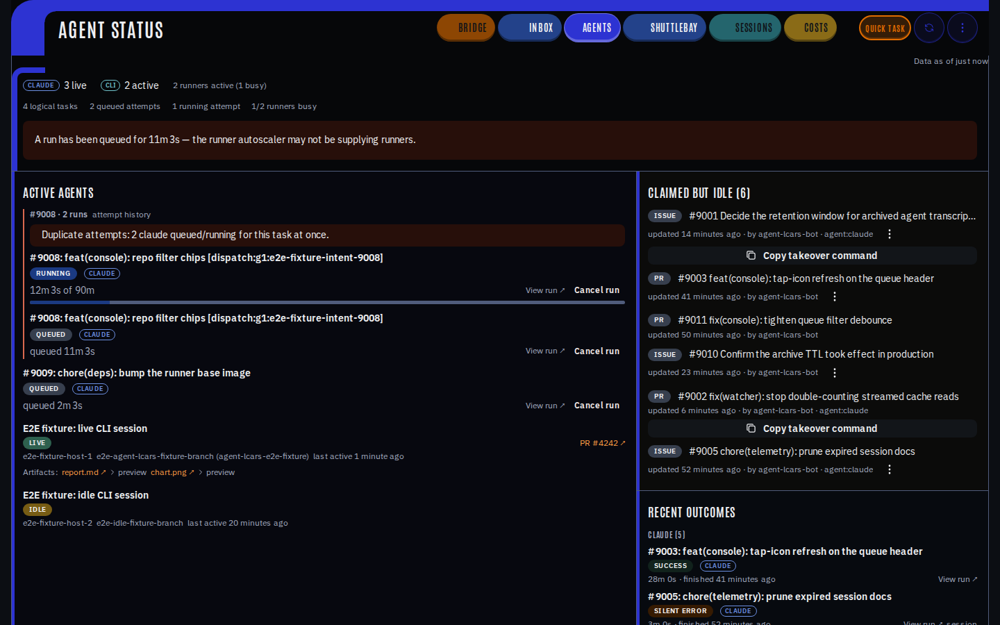
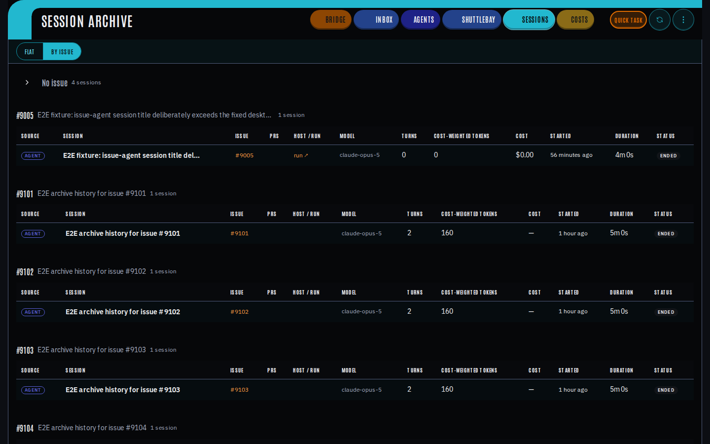

# Agent LCARS

Agent LCARS is the control plane for headless agent work across the fleet. It
admits Work from GitHub issues and pull requests, Linear issues, and native Work
requests (API, `lcars work` CLI and Console); runs coding pipelines on Claude
Code, Codex, OpenCode and Antigravity, repository-owned Goose jobs, and
repository-owned OpenClaw ("claw") agents; and launches those runs as
Kubernetes Jobs through the QueueExecutor. The Console runs its own short
summary Work directly. The Console shows maintainers where
attention is needed and retains the session evidence behind each outcome.



## Dispatch

To dispatch work, add exactly one routing label to an issue in an onboarded
repository:

| Label            | Agent       |
| ---------------- | ----------- |
| `agent:claude`   | Claude Code |
| `agent:codex`    | Codex       |
| `agent:opencode` | OpenCode    |
| `agent:agy`      | Antigravity |

The [shared agent protocol](.agents/skills/agent-protocol/reference/agent-protocol.md)
is the complete behavioral contract for every dispatched run. The
[LCARS skill](.agents/skills/lcars/SKILL.md) is a situational control-plane
reference for developers changing dispatch and reconciliation machinery. The
console then tracks the run from intake through review, merge, and any
maintainer follow-up.

## Operating surfaces

See [Operations](OPERATIONS.md) for Work API access and parked-item cleanup.

Use the console for decisions and inspection; use the supporting services when
working on a specific part of the fleet.

| Surface                                     | Use                                                   |
| ------------------------------------------- | ----------------------------------------------------- |
| Console Bridge (`/`)                        | Fleet overview                                        |
| Console Inbox (`/inbox`)                    | Pending decisions and completed reports               |
| Console Agents (`/agents`)                  | Active runs, claimed work, and recent outcomes        |
| Console Shuttlebay (`/shuttlebay`)          | Runner fleet: live runners and queue status           |
| Console Work (`/work`)                      | Native Work items, issues, and schedules              |
| Console Jobs (`/jobs`, `/jobs/credentials`) | Repository jobs, and job secrets and credential sets  |
| Console Sessions (`/sessions`)              | Search and inspect session records                    |
| Console Costs (`/costs`)                    | Session spend                                         |
| `apps/telemetry-watcher`                    | Interactive and CI session telemetry                  |
| `apps/runner-autoscaler`                    | QueueExecutor: claims, Kubernetes Jobs, and placement |
| `apps/runner-autoscaler/claw-image`         | Runner image for repository-owned claw agents         |
| `apps/github-actions-exporter`              | GitHub Actions metrics                                |
| `infra/terraform`                           | GCP services, IAM, storage, secrets, and budget       |

The [Console product spec](docs/product/console-product-spec.md) describes each
view in detail.

## Console views

The console keeps the active fleet, its decision queue, and its session
history in focused workspaces. The Decision Inbox is the starting point for
work that needs a human response; Agents is the live operational view; and the
Session Archive is the durable record for investigation and audit.

### Active agents



### Session archive



## Documentation map

The full task-oriented index is [`docs/README.md`](docs/README.md), and
[`ARCHITECTURE.md`](ARCHITECTURE.md) maps system ownership and proof
boundaries. Common entry points:

| Need                                    | Source of truth                                                                                   |
| --------------------------------------- | ------------------------------------------------------------------------------------------------- |
| Onboard a repository to the agent fleet | [Repository onboarding](docs/onboarding-repo.md)                                                  |
| Agent labels and routing                | [GitHub label contract](docs/github-label-contract.md)                                            |
| Credentials and GitHub App identity     | [Fleet credentials](docs/fleet-credentials.md) and [bot identities](docs/bot-identity-formats.md) |
| CI dispatch and published actions       | [Published actions](docs/published-actions.md)                                                    |
| Local/CI E2E boundary                   | [E2E security boundary](docs/e2e-security-boundary.md)                                            |
| E2E test policy                         | [E2E reliability](docs/e2e-reliability.md)                                                        |
| Runtime diagnosis                       | [Lifecycle systems](docs/lifecycle-systems.md)                                                    |

## Development

For setup, FQDN sharing, fixture reset, browser journeys, and troubleshooting,
use the [local console SUT playbook](docs/playbooks/local-console-sut.md).

Use the Node and pnpm versions pinned in `package.json`:

```sh
pnpm install
pnpm verify
```

For iterative console and Work API development against the credential-free
local emulators and synthetic fixtures, see the
[local console SUT playbook](docs/playbooks/local-console-sut.md):

```sh
pnpm dev                                       # http://127.0.0.1:4300 + emulator UI :4301
FQDN=dev.example.net pnpm dev:lan              # trusted-LAN preview
pnpm dev:reset && pnpm dev:status              # reset synthetic data / health check
pnpm dev:test                                  # run Playwright against the live stack
```

Start with the focused document that matches your task. This README intentionally
does not duplicate deployment steps, runner topology, credential setup, or
migration history; those operational contracts live with their owning systems
and should be verified there.

## Console startup configuration

The console validates static backend configuration before accepting requests.
Local development uses the same boot checks as production. Supply the runtime
variables declared in `apps/console/apphosting.yaml`, including the GitHub App
client ID and PEM private key, webhook secret, project and webhook queue/location,
`AUTH_URL`, `QUICK_TASK_EVIDENCE_BUCKET`, and `AGENT_LCARS_WORK_AUDIENCE`. Store
credentials in the supported private environment; never commit them. A blank
value or malformed App key fails startup with the variable name, without printing
the credential. Dispatch drains continue rebuilding token providers so key
rotation is still observed.

Hermetic E2E uses `tools/e2e/ci.env` plus an unregistered App key generated in
memory for each Playwright server launch. The standalone bundle smoke generates
its own ephemeral key. Neither path imports deployment credentials or bypasses
the production boot validator. An autoscaler using a custom Work audience must
set `LCARS_WORK_AUDIENCE` to match the console's explicit audience.
